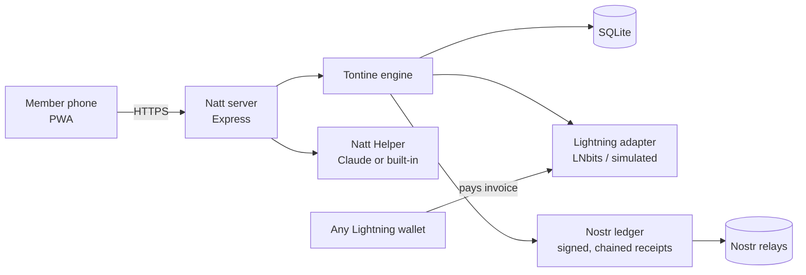

# Natt ⚡ Lightning tontines for West Africa

> *Natt* is the Wolof word for a **tontine**: a rotating savings group.
> Every week or month each member pays in, and one member takes the whole pot.
> The order rotates until everyone has received it once.

**Natt** puts the tontine on **Bitcoin Lightning**, keeps a tamper-evident
group ledger on **Nostr**, and adds an **AI helper** that answers questions
in plain French or English.

Built for the **Dakar Bitcoin Hack by Btrust (2026)**. MIT licensed.

[](https://github.com/shineyrbl-byte/natt/actions/workflows/ci.yml)

---

## The problem

Tontines are everywhere in Senegal and West Africa, but they run on cash and
a paper notebook:

- The organizer carries cash door to door and can lose it or be robbed.
- Disputes ("I paid!") are common, and an organizer can disappear with the pot.
- Family abroad pays 5–10 % in remittance fees to take part.

Full user story and pain points: [`docs/PROBLEM.md`](docs/PROBLEM.md).

## The solution

| | |
|---|---|
| ⚡ **Pay by Lightning** | Each member scans a QR code from any Lightning wallet (Wallet of Satoshi, Phoenix, Blink…). Diaspora members pay from anywhere in seconds. |
| 🎲 **Fair draw** | When the organizer starts the group, the payout order is drawn with a cryptographic random number generator and published. |
| 🔏 **Nobody can cheat** | Every payment and payout is a Nostr event signed by the group's key, and each one links to the previous one. Edit or delete a record and the chain breaks. The app shows a ✓ when the ledger verifies. |
| 🛡️ **Guarded payout** | The pot is only released to the member whose turn it is, only after everyone has paid, and only to an invoice for the exact pot amount. |
| 💬 **Natt Helper** | "C'est quand mon tour ?" "Qui n'a pas payé ?" Plain-language answers with FCFA amounts. Works offline with built-in answers; uses Claude when an API key is set. |
| 📱 **Made for real phones** | ~60 KB PWA, no framework, French by default, large buttons, works on 3G, installable. Invites go out over WhatsApp. |

## Quick start (one command)

```bash
docker compose up
```

or, with Node.js 22.13+:

```bash
npm install
npm run demo
```

Open **http://localhost:3000**. The demo seeds a 5-member market tontine
("Natt Marché HLM") mid-way through round 1 and prints a **secret link for
each member**. Open them in different browser profiles or private windows to
play each role.

Demo mode uses a **simulated Lightning wallet**: it issues real signed
regtest invoices, but no sats move. 🧪 buttons let you simulate payments.

### Happy path to try

1. Open **Aminata's** link → **Pay 10,000 sats** → QR code → 🧪 *simulate payment*.
2. Do the same for **Ibrahima**. The progress bar fills up: 5/5 paid.
3. Open **Fatou's** link (turn #1) → 🧪 *create a test invoice* → **Receive the pot**.
4. Round 2 opens. Open **🔏 Public ledger** to see every signed receipt and the ✓ verification.
5. Ask **Natt Helper**: "Who hasn't paid?"

### Real sats (LNbits)

```bash
cp .env.example .env
# set LIGHTNING_BACKEND=lnbits, LNBITS_URL, LNBITS_INVOICE_KEY, LNBITS_ADMIN_KEY
# optional: NOSTR_RELAYS=wss://relay.damus.io,wss://nos.lol
npm start
```

### Tests

```bash
npm test   # 27 tests: engine, Lightning, Nostr ledger, API, assistant
```

## Architecture



Details, components and the money flow: [`docs/ARCHITECTURE.md`](docs/ARCHITECTURE.md).

| Path | What |
|---|---|
| `src/tontine.js` | Groups, draw, rounds, contributions, guarded payouts |
| `src/lightning/` | Wallet interface, LNbits + simulated backends, BOLT11, Lightning address |
| `src/nostr.js` | Per-group keys, chained receipts, `verifyLedger()` |
| `src/assistant.js` | Natt Helper |
| `src/routes.js` | REST API + strict validation |
| `public/` | The web app |

## Security by design

Threat model with 11 threats and their mitigations: [`docs/THREAT_MODEL.md`](docs/THREAT_MODEL.md). Highlights:

- **Only the Lightning backend can mark a payment as paid**; the client never can.
- **Least privilege:** the LNbits invoice key is used for everything except payouts.
- **No secrets in the database:** group Nostr keys are derived from one server secret.
- **No PII in logs or on Nostr:** the logger redacts phones, invoices and keys; receipts use turn numbers, not names. Phones are visible to the organizer only.
- **Member tokens** are 128-bit random values stored only as SHA-256 hashes, sent in headers (never URLs), and compared in constant time.
- **Strict input validation** (unknown fields rejected), prepared SQL statements, 16 KB body limit, per-IP rate limiting.
- **Strict CSP**, no `innerHTML` with user data, non-root read-only container.
- **Payout checks:** exact amount, not expired, `collecting → paying → paid` lock against double payouts, and SSRF-safe Lightning-address resolution.

## Constraints (honest list)

- The pot sits in the group's LNbits wallet between collection and payout (custodial for that window).
- Payment detection polls the backend when the app refreshes. There are no webhooks yet.
- FCFA amounts use a configurable display rate, not a live price feed.

## Metrics we will track

Active groups per week · % of contributions paid on time · median time from
invoice to payment · payouts completed vs. scheduled · disputes raised.

## Next iteration

1. **Less custody:** hold invoices, so a member's payment only settles when the payout happens.
2. **Nostr login (NIP-07 / NWC)** and encrypted group chat (NIP-17).
3. **Reminders by SMS/WhatsApp**, drafted by Natt Helper.
4. **Live XOF rate** and **Wolof** UI strings.
5. Pilot with 10 organizers at Marché HLM, Dakar.

## Pitch

3-minute demo script: [`docs/PITCH.md`](docs/PITCH.md).

## License

MIT. See [LICENSE](LICENSE).
