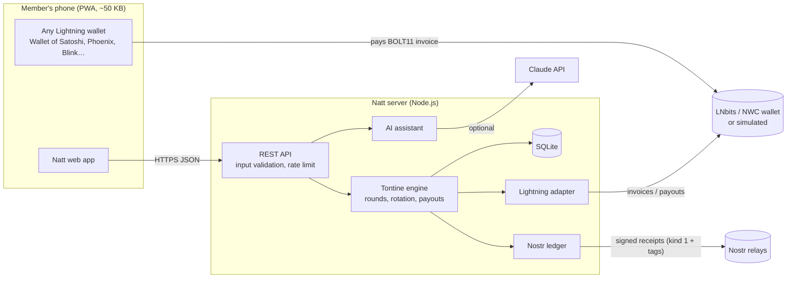

# Architecture

## Components

| Component | File | Role |
|---|---|---|
| HTTP server | `src/server.js`, `src/app.js` | Routes, security headers, rate limiting |
| Tontine engine | `src/tontine.js` | Groups, members, rounds, payout order |
| Lightning adapter | `src/lightning/` | One interface, several backends: `simulated` (demo), `lnbits` (real) |
| Nostr ledger | `src/nostr.js` | Signs a receipt event for each contribution and payout |
| AI assistant | `src/assistant.js` | Plain-language answers about a group; falls back to built-in answers when no API key is set |
| Storage | `src/db.js` | SQLite through Node's built-in `node:sqlite` (no native build) |
| Frontend | `public/` | Plain HTML/CSS/JS, no framework, works on 3G and mid-range phones |

## Money flow (one round)

1. The round opens. Natt creates one Lightning invoice per member for the
   contribution amount.
2. Members pay from any wallet. The adapter detects payment.
3. Natt records it and publishes a signed Nostr receipt.
4. When everyone has paid, the round's recipient gets the pot: they paste a
   Lightning invoice or address and the adapter pays it out.
5. The payout receipt is published and the next round opens.

## Constraints

- **Custody:** in this MVP the pot sits in the group's Lightning wallet
  (LNbits wallet) between collection and payout, typically minutes to days.
  See `docs/THREAT_MODEL.md`. Non-custodial options are on the roadmap.
- **Exchange rate:** amounts are stored in sats. FCFA is shown for display
  only. The rate comes from a public BTC/EUR price (FCFA is pegged to the
  euro at 655.957), refreshed every 10 minutes, with a configured fallback.
  A wrong price can only change the FCFA label, never an amount paid.
- **Connectivity:** the app shell is cached by a service worker; payment needs
  a connection.
